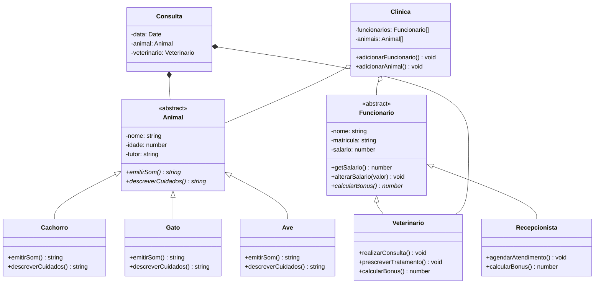

<h1 align="center">🐾 Clínica Veterinária da Dona Marta</h1>

<p align="center">
  Sistema de gerenciamento de atendimentos de uma clínica veterinária, feito em TypeScript para praticar Programação Orientada a Objetos.
</p>

<p align="center">
  
  
  
</p>

---

## 📖 Sobre o projeto

Dona Marta abriu uma clínica veterinária e precisa de um sistema para gerenciar os atendimentos. O sistema modela:

- **Animais** (cachorros, gatos e aves), cada um com seu jeito de emitir som e de ter cuidados diários.
- **Funcionários** (veterinários e recepcionistas), cada um com seu cálculo de bônus.
- **Consultas**, que ligam um animal a um veterinário em uma data.
- **A clínica**, que reúne funcionários e animais cadastrados.

## 🎯 Conceitos de POO praticados

| Conceito | Onde aparece |
|---|---|
| **Classes abstratas** | `Animal` e `Funcionario` definem o que é comum e obrigam as filhas a implementar o que varia |
| **Herança** | `Cachorro`, `Gato` e `Ave` estendem `Animal`; `Veterinario` e `Recepcionista` estendem `Funcionario` |
| **Polimorfismo** | Cada espécie implementa `emitirSom()` e `descreverCuidados()` do seu jeito; cada cargo calcula o próprio `calcularBonus()` |
| **Encapsulamento** | O salário é `private` e só muda pelo método `alterarSalario()`, que valida o valor |
| **Composição** | Uma `Consulta` não existe sem um `Animal` e um `Veterinario` |
| **Agregação** | A `Clinica` tem funcionários e animais, mas eles continuam existindo se ela fechar |

## 🗺️ Diagrama de classes

> O diagrama abaixo é renderizado automaticamente pelo GitHub. Getters e setters foram omitidos para deixá-lo mais legível.



**Legenda**

| Símbolo | Significado |
|---|---|
| `◁──` | Herança |
| `◆──` | Composição (a parte não existe sem o todo) |
| `◇──` | Agregação (a parte existe sem o todo) |
| `-` / `#` / `+` | Visibilidade: `private` / `protected` / `public` |
| `*` | Método abstrato |

## 📁 Estrutura do projeto

```
clinica-veterinaria/
├── package.json
├── tsconfig.json
├── .gitignore
└── src/
    ├── animais/
    │   ├── Animal.ts
    │   ├── Cachorro.ts
    │   ├── Gato.ts
    │   └── Ave.ts
    ├── funcionarios/
    │   ├── Funcionario.ts
    │   ├── Veterinario.ts
    │   └── Recepcionista.ts
    ├── Consulta.ts
    ├── Clinica.ts
    └── main.ts
```

## 🚀 Como executar

**Pré-requisitos:** [Node.js](https://nodejs.org/) instalado.

```bash
# 1. Clone o repositório
git clone https://github.com/SEU-USUARIO/NOME-DO-REPOSITORIO.git

# 2. Entre na pasta do projeto
cd clinica-veterinaria

# 3. Instale as dependências
npm install

# 4. Execute o arquivo principal
npx ts-node src/main.ts
```

## 💡 Exemplo de uso

```typescript
import { Cachorro } from "./animais/Cachorro";
import { Gato } from "./animais/Gato";

const rex = new Cachorro("Rex", 3, "Ana");
const mia = new Gato("Mia", 2, "Carlos");

console.log(rex.emitirSom());          // Au Au
console.log(mia.emitirSom());          // Miau
console.log(rex.descreverCuidados());
```

## 🧱 Regras de negócio

- Todo animal tem **nome**, **idade** e **tutor**, e precisa emitir seu som e descrever seus cuidados diários.
- Todo funcionário tem **nome**, **matrícula** e **salário**.
- O **bônus** do veterinário é calculado por consulta realizada, e o do recepcionista por agendamento confirmado.
- O **salário** nunca é alterado diretamente: apenas por `alterarSalario()`, que rejeita valores inválidos.
- Uma **consulta** exige um animal, um veterinário e uma data.
- Se a **clínica** fechar, funcionários e animais continuam existindo.

## ✅ Status do desenvolvimento

- [x] Classe abstrata `Animal`
- [x] `Cachorro`, `Gato` e `Ave`
- [x] Classe abstrata `Funcionario` (com encapsulamento do salário)
- [ ] `Veterinario`
- [ ] `Recepcionista`
- [ ] `Consulta`
- [ ] `Clinica`
- [ ] Arquivo de teste `main.ts`

## 🛠️ Tecnologias

- [TypeScript](https://www.typescriptlang.org/)
- [Node.js](https://nodejs.org/)
- [ts-node](https://typestrong.github.io/ts-node/)

## 👤 Autor

Feito com 💙 por **Vinícius Valentim Dos Santos** como atividade de Programação Orientada a Objetos.

[](https://github.com/Viniiwxz7)
